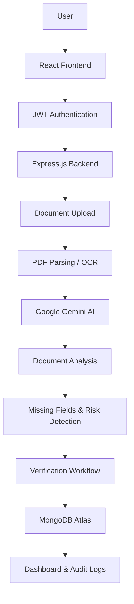

# DocuSure — AI-Powered Document Verification & Compliance Platform 📄🤖

**Verify Documents. Detect Risks. Simplify Compliance.**

DocuSure is an AI-powered document verification and compliance management platform designed to automate document processing, detect inconsistencies, and streamline verification workflows.

The platform leverages AI to extract structured information from uploaded documents, identify missing fields, detect expiry dates, highlight unusual clauses, and assist reviewers in making faster and more informed verification decisions.

## 🚀 Key Features

### 📤 Document Management
- Upload and manage documents including contracts, invoices, certificates, IDs, and forms.
- Organize documents by category and verification status.
- Maintain document versions and access uploaded files.
- Track document verification progress.

### 🧠 AI-Powered Document Analysis
- Extract structured information from uploaded documents.
- Identify missing fields and inconsistent information.
- Detect document expiry dates.
- Automatically categorize documents.
- Highlight unusual clauses and potentially risky contract terms.
- Generate AI-assisted document analysis results using Google Gemini.

### 🔍 Verification & Review Workflow
- Review extracted document information.
- Approve or reject submitted documents.
- Track pending, approved, and rejected documents.
- Maintain verification history for accountability.

### 🔐 Authentication & Security
- Secure user authentication using JWT.
- Password hashing with bcrypt.
- Role-based access control.
- Organization-level data isolation.
- Protected API routes and authorized document access.

### 📊 Dashboard & Compliance Tracking
- Centralized document verification dashboard.
- Monitor document statuses and verification activity.
- Track document expiry information.
- Maintain audit logs of important actions.
- Receive expiry-related reminders.

## 🛠️ Tech Stack

| Layer | Technologies |
|---|---|
| Frontend | React.js, Vite, Tailwind CSS |
| Backend | Node.js, Express.js |
| Database | MongoDB Atlas, Mongoose |
| Authentication | JWT, bcrypt |
| AI Integration | Google Gemini API |
| Document Processing | PDF Parsing, OCR |
| File Handling | Local Development Storage |
| API Architecture | REST APIs |

## 🏗️ System Architecture



## 🔄 How It Works

1. **User Authentication:** Users securely register and log in using JWT-based authentication.
2. **Document Upload:** Users upload documents for verification.
3. **Document Processing:** The backend processes uploaded files using PDF parsing and OCR.
4. **AI Analysis:** Google Gemini analyzes extracted content and identifies missing information, inconsistent dates, expiry details, and unusual clauses.
5. **Verification:** Reviewers examine the AI-generated results and approve or reject documents.
6. **Compliance Monitoring:** The dashboard tracks document statuses, expiry information, and verification history.

## 📁 Project Structure

```text
DocuSure/
│
├── client/
│   ├── public/
│   └── src/
│       ├── assets/
│       ├── components/
│       ├── pages/
│       ├── context/
│       ├── hooks/
│       ├── services/
│       ├── App.jsx
│       └── main.jsx
│
├── server/
│   ├── config/
│   ├── controllers/
│   ├── middleware/
│   ├── models/
│   ├── routes/
│   ├── services/
│   ├── uploads/
│   └── server.js
│
├── .gitignore
└── README.md
```

## ⚙️ Installation & Setup

### 1. Clone the Repository

```bash
git clone YOUR_GITHUB_REPOSITORY_URL
cd DocuSure
```

### 2. Install Dependencies

For the frontend:

```bash
cd client
npm install
```

For the backend:

```bash
cd ../server
npm install
```

### 3. Configure Environment Variables

Create a `.env` file inside the server directory.

```env
PORT=5000

MONGODB_URI=your_mongodb_connection_string

JWT_SECRET=your_secure_jwt_secret

GEMINI_API_KEY=your_gemini_api_key

CLIENT_URL=http://localhost:5173

MAX_FILE_SIZE=10485760
```

**Note:** Never expose API keys, database credentials, or JWT secrets in your frontend or public repository.

### 4. Run the Application

Start the backend:

```bash
cd server
npm run dev
```

Start the frontend in another terminal:

```bash
cd client
npm run dev
```

Open the local development URL provided by Vite in your browser.

*Note: Run commands according to the scripts configured in your package.json files.*

## 🔐 Security Implementation

DocuSure incorporates multiple security mechanisms:

- JWT-based authentication for protected routes.
- bcrypt password hashing.
- Role-based authorization.
- Organization-level access restrictions.
- Backend validation of document access permissions.
- Secure environment variable management.
- Audit logging for verification activities.

## 🎯 Use Cases

- **HR Departments:** Verify employee identity documents and certificates.
- **Financial Organizations:** Process invoices and supporting documents.
- **Legal Teams:** Analyze contracts and identify unusual clauses.
- **Compliance Teams:** Track document expiry and verification status.
- **Businesses:** Automate document review and reduce manual processing.

## 🔮 Future Enhancements

- Advanced OCR for scanned and image-based documents.
- Multi-language document extraction.
- AI-powered fraud and tampering detection.
- Automated compliance scoring.
- Email and notification integrations.
- Cloud-based document storage.
- Advanced analytics and reporting.

## 👨‍💻 Author

**Ujjwal Awasthi**

- GitHub: [@ujjwalawasthi7597-del](https://github.com/ujjwalawasthi7597-del)
- LinkedIn: [Ujjwal Awasthi](https://www.linkedin.com/in/ujjwal-awasthi-90942237b/)
- Email: ujjwalawasthi7597@gmail.com

---

⭐ If you find DocuSure interesting, consider giving this repository a star!

**DocuSure — Making Document Verification Smarter, Faster, and More Reliable.**
