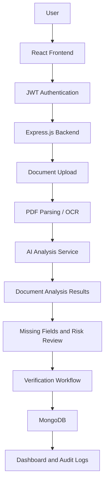

# DocuSure — AI-Powered Document Verification & Compliance Platform 📄🤖

**Verify Documents. Detect Risks. Simplify Compliance.**

DocuSure is an AI-powered document verification and compliance management platform designed to streamline document processing, identify inconsistencies, and support faster, more informed verification decisions.

The platform helps users manage uploaded documents, extract useful information, review potential issues, and track verification workflows from a centralized dashboard.

## 🌐 Live Demo

🚀 **[Visit DocuSure — Live Application](https://docusure-ai-document.ai.studio)**

## 🚀 Key Features

### 📤 Document Management
- Upload and manage documents such as contracts, invoices, certificates, IDs, and forms.
- Organize documents by category and verification status.
- Track document verification progress.
- Access document information from a centralized workspace.

### 🧠 AI-Powered Document Analysis
- Extract structured information from uploaded documents.
- Identify missing fields and inconsistent information.
- Detect document expiry dates.
- Categorize documents for easier review.
- Highlight unusual clauses and potentially risky contract terms.
- Generate AI-assisted analysis to support human reviewers.

### 🔍 Verification & Review Workflow
- Review extracted document information.
- Approve or reject submitted documents.
- Track pending, approved, and rejected documents.
- Maintain a history of verification activities.

### 🔐 Authentication & Security
- JWT-based user authentication.
- Password hashing with bcrypt.
- Role-based access control.
- Protected API routes and authorized document access.
- Secure handling of application secrets through environment variables.

### 📊 Dashboard & Compliance Tracking
- Centralized document verification dashboard.
- Monitor document statuses and verification activity.
- Track document expiry information.
- Maintain audit logs of important actions.

## 🛠️ Tech Stack

| Layer | Technologies |
|---|---|
| Frontend | React.js, Vite, Tailwind CSS |
| Backend | Node.js, Express.js |
| Database | MongoDB Atlas, Mongoose |
| Authentication | JWT, bcrypt |
| AI Integration | Google Gemini API |
| Document Processing | PDF Parsing, OCR |
| API Architecture | REST APIs |

## 🏗️ System Architecture



## 🔄 How It Works

1. **User Authentication:** Users sign in through the authentication flow.
2. **Document Upload:** Users upload documents for verification.
3. **Document Processing:** The backend processes uploaded files and extracts their content.
4. **AI Analysis:** The analysis service reviews extracted content for missing information, inconsistencies, expiry details, and potentially unusual clauses.
5. **Verification:** Reviewers examine the analysis and make the final approval or rejection decision.
6. **Compliance Monitoring:** The dashboard helps track document statuses and verification activity.

## 📁 Project Structure

```text
DocuSure/
│
├── client/
│   ├── public/
│   └── src/
│       ├── assets/
│       ├── components/
│       ├── pages/
│       ├── context/
│       ├── hooks/
│       ├── services/
│       ├── App.jsx
│       └── main.jsx
│
├── server/
│   ├── config/
│   ├── controllers/
│   ├── middleware/
│   ├── models/
│   ├── routes/
│   ├── services/
│   ├── uploads/
│   └── server.js
│
├── .gitignore
└── README.md
```

*The structure above is representative. Adjust it according to the actual repository.*

## ⚙️ Installation & Setup

### 1. Clone the Repository

```bash
git clone YOUR_GITHUB_REPOSITORY_URL
cd DocuSure
```

### 2. Install Dependencies

Frontend:

```bash
cd client
npm install
```

Backend:

```bash
cd ../server
npm install
```

### 3. Configure Environment Variables

Create a `.env` file inside the server directory:

```env
PORT=5000
MONGODB_URI=your_mongodb_connection_string
JWT_SECRET=your_secure_jwt_secret
GEMINI_API_KEY=your_gemini_api_key
CLIENT_URL=http://localhost:5173
MAX_FILE_SIZE=10485760
```

**Security Note:** Never commit `.env` files, API keys, database credentials, or JWT secrets to a public repository. Use the exact environment variable names required by your backend.

### 4. Run the Application

Start the backend:

```bash
cd server
npm run dev
```

Start the frontend in another terminal:

```bash
cd client
npm run dev
```

Open the local development URL provided by Vite in your browser.

*Run commands according to the scripts configured in your package.json files.*

## 🔐 Security Considerations

- JWT authentication for protected routes.
- Password hashing instead of plain-text password storage.
- Backend authorization checks.
- Uploaded file type and size validation.
- Secure environment variable management.
- Document access restrictions.
- Audit logging for important verification activities.

## 🎯 Use Cases

- **HR Teams:** Organize and review employee documents and certificates.
- **Financial Teams:** Process invoices and supporting documents.
- **Legal Teams:** Review contracts and flag clauses for closer inspection.
- **Compliance Teams:** Track document status and expiry information.
- **Businesses:** Streamline repetitive document review workflows.

## 🔮 Future Enhancements

- Advanced OCR for scanned and image-based documents.
- Multi-language document extraction.
- Enhanced fraud and tampering detection.
- Automated compliance scoring.
- Email and notification integrations.
- Cloud-based document storage.
- Advanced analytics and reporting.

## 👨‍💻 Author

**Ujjwal Awasthi**

- GitHub: [@ujjwalawasthi7597-del](https://github.com/ujjwalawasthi7597-del)
- LinkedIn: [Ujjwal Awasthi](https://www.linkedin.com/in/ujjwal-awasthi-90942237b/)
- Email: ujjwalawasthi7597@gmail.com

---

⭐ If you find DocuSure interesting, consider giving this repository a star!

**DocuSure — Making Document Verification Smarter, Faster, and More Reliable.**
